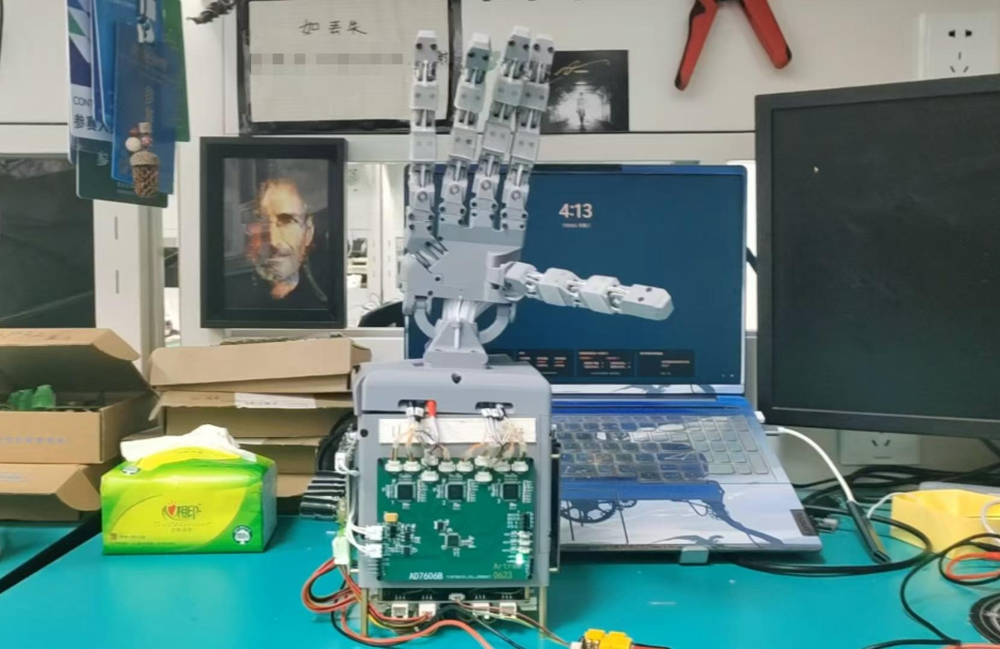
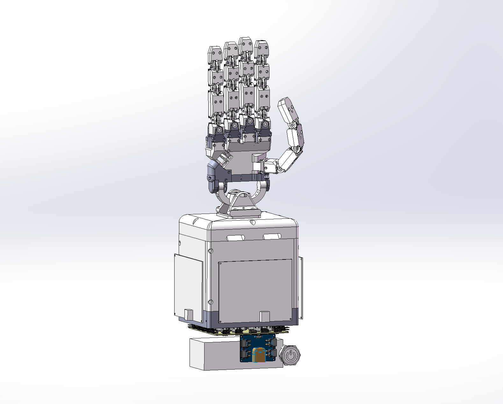
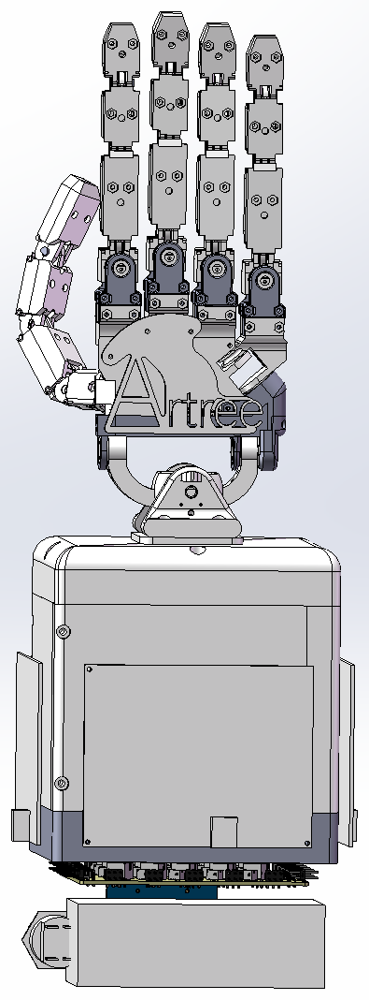
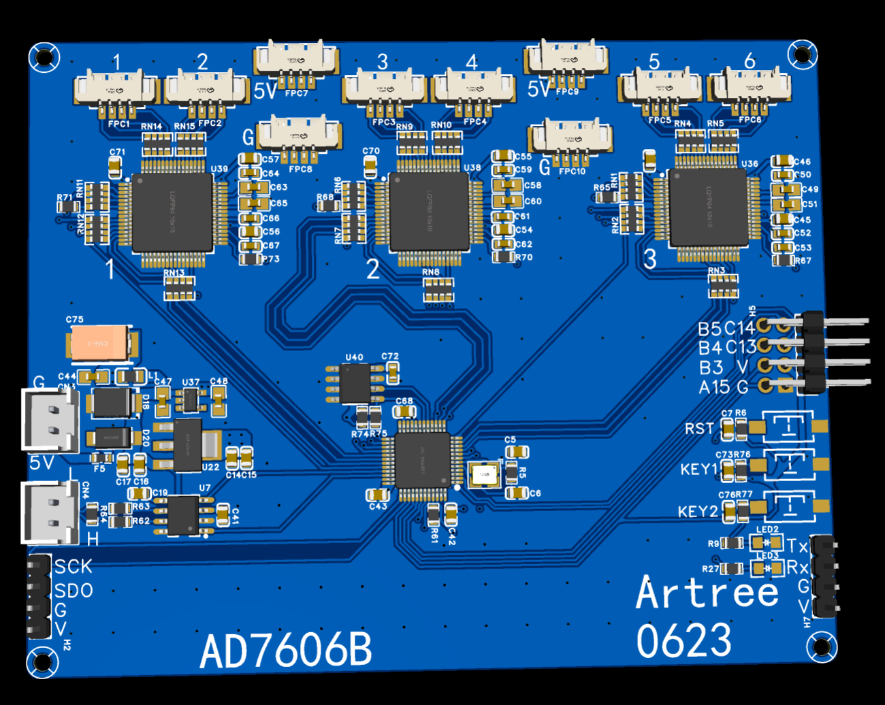
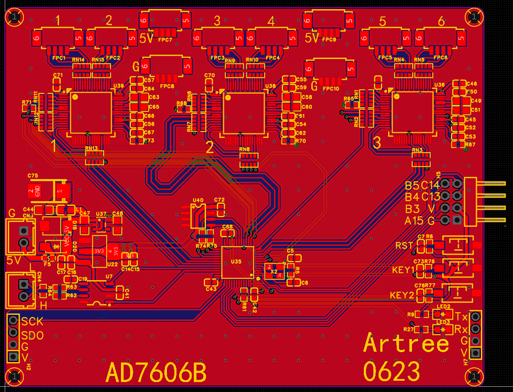
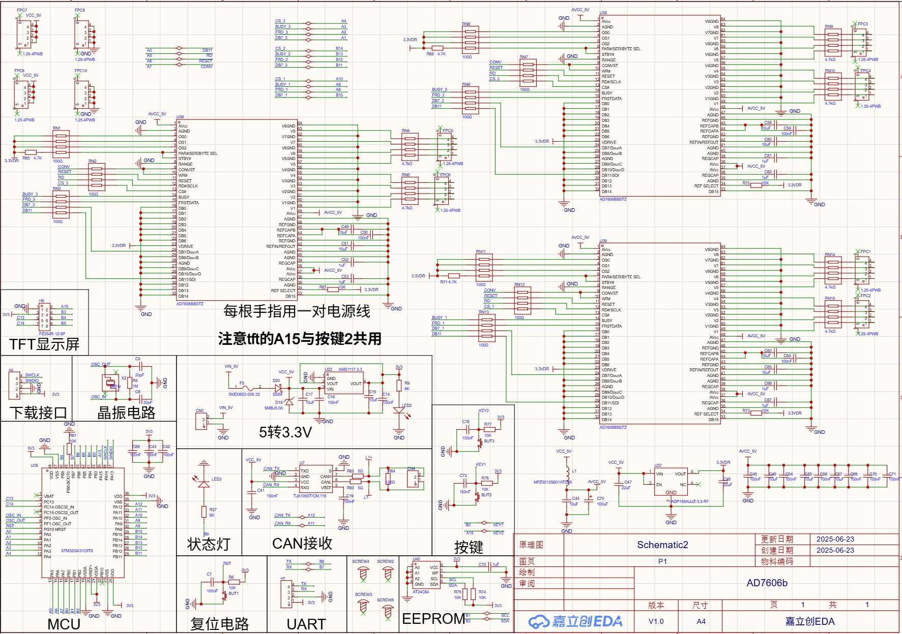

 

# OpenTendonHand

**An open-source high-DOF tendon-driven dexterous hand**

This repository publishes the mechanical models, PCB files and design
documentation of a tendon-driven dexterous hand, for study, reproduction and
further development.

  
  &nbsp;&nbsp;&nbsp;
  

## Contents

| Directory | Contents |
| --- | --- |
| `solidworks/` | SolidWorks 2025 source models: 60 parts + 8 assemblies, features intact |
| `step/` | Whole-hand STEP, opens in any CAD software |
| `pcb/` | Gerber files; schematic and layout published on OSHWHub |
| `images/` | Photos, PCB renders and schematic |
| `docs/` | Design document `机械手.pdf` |

## PCB

The controller board (AD7606B) is published on OSHWHub (Chinese), together with
its schematic, PCB, BOM and fabrication files:

**https://oshwhub.com/shusheng60602/ad7606b**

Gerber files: [`pcb/AD7606b-gerber.zip`](pcb/AD7606b-gerber.zip)

**3D render**

**PCB front**

**Schematic**

## Design document

[`docs/机械手.pdf`](docs/机械手.pdf) (17 pages, Chinese)

> This document was put together by [@Artree021](https://github.com/Artree021)
> during undergraduate student competitions. It is provided for reference only:
> content is not guaranteed to be accurate, complete or up to date.

## Notes

- Units: millimetres (mm).
- Just want to look at the structure, or use another CAD package: open `step/`.
- Want to modify the design: open `solidworks/`, the features are intact.
- This is a design archive. Files are published as-is and are not actively
  maintained.

## License

Mechanical models, PCB files and documentation are released under
[CERN-OHL-S-2.0](LICENSE): free to use, modify and manufacture; modified design
files must be published under the same license. Personal builds and academic use
are unrestricted.

## Feedback

Issues are welcome and will be recorded.
